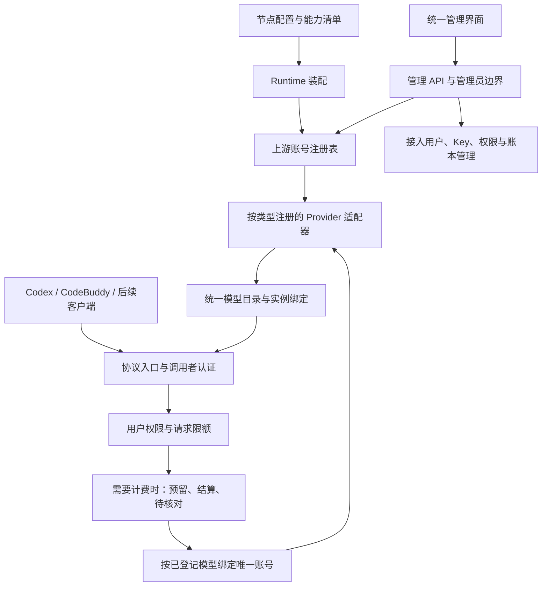

# Bifröst 架构 Review 与账号池设计

2026-11-01。Review 基线：`bf3b695`。本文是下一轮重构的设计与迁移契约；账号池界面、多实例运行时和下述新管理 API 尚未部署。现有调用、登录、用户 Key、余额及模型 ID 继续由当前实现处理。已实现的公司 Server 远端接入见 [Server 远端来源](server-remote-sources.md)。

## 核心决定

一个网关内核、一套管理界面，按该节点实际启用的能力装配。账号池管理**提供模型与额度的上游账号实例**；接入用户管理**消费这些模型的下游用户**；管理员是第三种身份。三者不共用身份、凭据或余额。

公司节点可以配置 CodeBuddy、Cursor、Codex 订阅和远端 Bifröst 用户账号。当前 Mac 公网节点只配置隔离环境中的 Claude 账号，以及下游用户和计费能力。页面不为未配置的类型创建空卡，也不因为操作系统或访问地址猜测部署用途。

“账号池”首先表示可管理的实例集合。每个模型绑定一个明确实例；本次设计不默认引入账号轮询、故障转用其他账号或余额不足时改用公司额度。

## Review 发现

| 优先级 | 当前事实及代码位置 | 影响与处理 |
| --- | --- | --- |
| P1 | `public/index.html` 固定展示 A/B、CodeBuddy、Cursor、With，并混入本机 Codex 连接设置 | Mac 单 Claude 来源仍出现公司节点的管理内容。页面改为按能力及实际账号实例生成；客户端连接移到独立区域 |
| P1 | `src/main.mjs` 无条件装配 Cursor、CodeBuddy 和 Codex 相关对象；Mac Claude 是后续可选分支 | 页面隐藏卡片仍不能形成清晰运行边界。Runtime 只装配配置中启用的账号类型及功能；公网 Claude 节点不依赖本机 Codex 登录/RPC |
| P1 | `src/gateway.mjs` 仍保留 A/B、CodeBuddy、Cursor 专用分支；`ModelRouter` 目前用于 Desktop 和 Server 的远端来源 | 文档不能把全部现有来源描述为已统一路由。逐个迁移到同一注册表，保持现有协议转换及别名兼容 |
| P1 | CodeBuddy、Cursor 的现有 Server 装配各为一个固定服务；Codex B 也只有一个独立目录 | 同类型多账号涉及独立凭据、会话和运行生命周期。新账号必须是实例，不能复制一张卡后复用原登录 |
| P1 | `ModelDiscovery` 固定发现 CodeBuddy/Cursor，`ModelPolicy` 仍按渠道归类；Mac 用户目录另由 `macClaude.models()` 提供 | 管理页、客户端模型列表及用户可授权模型可能来自不同目录。统一成带账号实例归属的发布目录，各种视图读取同一份快照 |
| P1 | `UsageLedger`、`RequestDiagnostics` 主要记录渠道和模型，没有独立上游账号字段 | 同类型多账号无法可靠区分用量、故障及授权代次。新增可追踪的实例标识，并兼容读取旧记录；不重写历史账本 |
| P2 | `AccountQuotas`、`ProviderQuotas` 和页面按预设渠道展示额度 | 改为每实例的能力描述。只有上游实际返回的额度才显示数值，未知不会显示为 0 或由 Token 统计推算 |
| P2 | `with-service.mjs` 是既有 With/VM 适配；当前 Mac Claude 走 `mac-claude-client.mjs` 与隔离 relay | 两个不同实现不能仅靠改名称合并。当前 Mac 导入为 Claude 隔离账号；未配置的 With 兼容来源不显示 |
| P2 | 管理入口信任本机回环会话；注册用户库没有管理员角色 | 账号池不会自动把某个注册用户提升为管理员。若扩展远程管理，应另做管理员身份验证，不能复用普通模型 Key |

现有的隔离网络、个人 Bifröst Key、单次远端调用、状态封装、故障不回退和权威账本值得保留。此 Review 不将原有实现一概替换，也不恢复已暂停的真实收款验收。

## 结构与职责



| 层 | 负责 | 不负责 |
| --- | --- | --- |
| 节点配置与 Runtime | 选用哪些能力、账号适配器、监听和安全存储；生命周期与恢复 | 不按模型名称猜目标，不替客户端切换公司/公网模式 |
| 上游账号池 | 实例身份、名称、类型、启停意图、凭据引用、授权代次、健康快照 | 不保存下游用户密码，不把套餐余额当客户现金余额 |
| Provider 类型适配器 | 本实例登录、刷新、目录、原生调用及取消；声明能力 | 不选择备用账号，不决定下游用户价格 |
| 统一模型目录与路由 | 合并实例模型、发布兼容 ID、查权限与开关、构造可信路由上下文 | 不把客户端提供的 URL、账号 ID 或 metadata 当作可执行路由 |
| 通用协议转换 / 客户端适配 | 格式、工具、签名、状态、流式与各客户端目录视图 | 不拥有上游登录，不复制用户账本 |
| 用户权限与计费 | 下游用户、Key、模型白名单、限流、余额、预留、核销 | 不保管员工登录，不从未知用量猜扣费 |
| 诊断与用量 | 关联节点、账号实例、模型、请求、授权代次和实际用量 | 不保存提示词、工具正文、Cookie 或密钥 |

新增客户端主要扩展 `clients/`；新增服务商主要扩展 Provider 注册表；新增同类账号创建实例。三种扩展不要求修改其他两类的授权和账本。

## 账号类型与账号实例

类型定义是代码，实例是节点配置，实时状态是运行快照。它们不能混成一份会反复覆盖的对象。

建议类型标识：

| 类型 | 授权位置 | 实例隔离要求 |
| --- | --- | --- |
| `codex-subscription` | 运行该账号的受控环境 | 独立 Codex home、会话和身份绑定；不复制当前客户端登录 |
| `codebuddy-employee` | 公司电脑 | 独立员工授权及安全存储、目录缓存、思考状态 |
| `cursor-account` | 运行该账号的电脑 | 独立授权、SDK/Agent 会话和兼容模式 |
| `claude-cli` | 受管理的隔离环境 | 独立 Claude 配置、会话及 relay 绑定；持久 CLI 凭据不复制到宿主或普通客户端 |
| `bifrost-user` | 本节点保存普通用户 Key | 固定 HTTPS 用户 API、独立 Key、授权代次；不使用远端管理凭据 |

当前旧 Server 适配器每类型单实例的限制必须在类型能力中明确声明。界面只有在适配器、凭据和运行生命周期都支持后，才允许添加第二个同类型实例。已有远端来源注册最多 8 个的限制同样显式呈现；不能以目标设计声称当前全部类型已支持多账号。

类型能力至少包含：`authMethods`、`supportedProtocols`、`supportsMultipleAccounts`、`maxAccounts`、`quotaReadable`、`managedAuthorization`、可用操作与字段描述。节点根据已安装适配器、凭据存储与配置返回实际可用类型，前端不写平台分支。

每个实例有稳定、不可由名称推导的 `accountId`。示例仅表示目标结构，不是可直接写入当前生产配置的格式：

```json
{
  "accountId": "upstream-claude-01",
  "type": "claude-cli",
  "name": "隔离 Claude",
  "enabled": true,
  "credentialRef": "opaque-store-reference",
  "connectionRef": "managed-relay-reference"
}
```

授权状态、就绪状态、模型数、上次错误和套餐快照由运行时读取，不写入上述配置作长期事实。`authEpoch` 由受信任的凭据变化驱动，不能由浏览器填写。启用意图与健康状态分别保存：网络临时失败不自动修改启停配置。

新增 Claude 实例先有独立隔离授权环境，再登记 relay 与凭据引用；不能把同一 CLI 登录重复登记成两个账号。交互网页可以沿用已获准的专用浏览器和 VPS 授权流程，持久 CLI 凭据仍归隔离环境。是否共用虚拟机由隔离执行器能力决定，共用时仍须独立配置、进程和会话。

## 一套页面，两种节点

默认导航：概览、账号池、模型、客户端接入、设置。启用下游用户能力的节点才显示“用户与计费”。

- **公司节点**：账号池只列已接入实例，例如公司 CodeBuddy、本人 Cursor、远端 Bifröst 用户账号。添加账号时先选类型，再进入该类型实际支持的授权流程。Codex 官方/网关连接模式放在“客户端接入”，当前 Codex 登录不再作为固定“账号 A”卡混进上游池。
- **当前 Mac 公网节点**：账号池只显示隔离 Claude；概览只展示该来源、已发布模型和服务状态。“用户与计费”保留现有注册用户、Key、模型权限及账本。不展示未接入的公司账号、Codex 登录和旧 With 配置。

账号池主列表保留名称、类型、状态、模型数、额度摘要和管理操作。授权、套餐明细、运行位置、接入限制、原始来源说明和诊断放入选中账号的详情。没有可靠额度接口时展示“上游未提供”，并给实际可用的官网入口。

“添加账号”由类型描述生成表单。普通 OAuth 在所属电脑授权；隔离 Claude 的操作必须交给受管理环境；Bifröst 用户账号填写自己的用户 API 与 Key。创建成功不等于登录成功或推理通过，分别显示待授权、待验证、就绪或不可用。

部署能力由服务端返回，浏览器不提供一个影响真实路由的“内网/外网”开关。设计稿中的部署切换只用于比较页面。

## 模型、会话与请求边界

内部模型记录至少带 `routeId`、`accountId`、上游准确模型 ID、协议能力、客户端展示信息和授权代次。客户端公开别名由目录注册，不在 HTTP handler 中通过拼接模型名建立连接。

现有 `B-*`、`CodeBuddy-*`、`Cursor-*`、`remote/bifrost/Claude-*` ID 在迁移期间作为兼容别名保留，绑定原实例。同类型新增实例需要无歧义的实例命名空间；重命名显示名称不改变账号 ID 或已有模型 ID。别名冲突直接拒绝。不能在后台把旧别名悄悄绑定到新账号。

用户选择模型即选择其来源。换账号、类型或授权后，历史状态不能直接重用；思考、签名、工具回合及缓存绑定 owner、session、accountId、routeId 和 authEpoch。工具由发起请求的客户端执行。已有 `ModelRouter`、状态封套和 Responses/Messages 转换继续复用，并逐步接纳旧路由。

本地公司请求不把凭据、目录、提示或工具结果送到 Mac。远端调用只携带该 Bifröst 用户 Key。池中账号的请求失败不会自动重试或转交其他账号。以后若增加同质账号组调度，应作为显式、可审计的新能力，另外定义计费与会话约束。

当前 Mac 的 Claude 实例迁移时须保留原隔离网络边界：虚拟机的专用出站代理和 VPS、无直连回退、DNS 接管以及 IPv6/UDP 限制。账号池只引用既有受管 relay，不提供绕过网络隔离的任意端口或宿主执行命令。公司适配器不继承这条专用代理；新账号不得通过切换整个进程的代理环境实现路由。

## 两种额度与管理员身份

上游套餐/公司额度是 Provider 提供的账号资源；下游用户余额是本节点对客户的账本。它们不同步、不合并为一个余额字段。

- 公司来源使用公司授权和上游额度，本节点只记实际用量。
- 远端 Bifröst 来源由远端按该普通用户 Key 校验并结算，本地不再扣第二份钱；需要看余额时使用用户级只读能力，不调用远端管理员接口。
- Mac 对下游用户预留及结算，其账本为权威；上游 Claude 登录本身不变成一个注册用户。
- 收款证据与额度交付仍须独立幂等核验。此次架构重构不启用充值，不执行暂停的正式支付测试。

当前管理权限继续受本机回环会话保护；独立管理员登录是单独能力，不通过客户注册或模型 API Key 授予。账号池管理操作和用户账本操作使用不同管理服务及审计动作。

## 管理 API 的目标契约

以下路径为待实施契约，不是当前可调用接口：

```text
GET  /api/node                         当前节点能力与版本
GET  /api/upstream-account-types       实际可添加类型、限制和所需授权
GET  /api/upstream-accounts            已登记账号的安全快照
POST /api/upstream-accounts            创建指定类型的账号实例
POST /api/upstream-accounts/:id/...    按适配器实际能力执行授权/刷新/启停
GET  /api/model-catalog                同一份按实例归属的发布目录
```

保留现有 `/api/client-admin` 作为下游用户与计费服务，在内部逐步使用更明确的命名。旧管理 API 由兼容层转发到固定迁移实例，不与新服务各维护一份状态。所有写操作保留本机管理员认证、CSRF、版本冲突检测和白名单校验；响应不回显完整凭据。

只有配置中已登记的固定目标可以成为 Provider。浏览器请求不能给任意来源指定转发 URL、凭据路径或执行命令；配置受信任目标时按对应类型的受限表单验证。新增来源失败不影响原实例，不生成半激活路由。

## 迁移顺序与验收

1. **节点与类型契约**：实现能力清单和账号注册表，把现有配置导入为稳定实例。形成迁移日志；原始授权文件和数据保留，旧槽位只作兼容绑定。首先让 Mac 只装配实际 Claude 与用户计费功能。
2. **管理页**：使用账号快照渲染列表、详情和按类型添加；移动客户端连接设置。保留现有视觉风格、用户页设计和已有授权流程。仅有外观变化的版本不宣称支持多实例。
3. **目录与路由**：统一发现、模型开关、客户端列表和用户白名单；逐类把旧分支接入同一 `ModelRouter`。验证旧 ID、公司路由、远端 Key、工具接续及故障不回退。
4. **多实例与记录**：对每种已完成隔离的适配器开放多账号，扩展用量/诊断实例标识。旧记录归属未知时保留未知；不猜测或改写历史金额。新增实例与客户账号、API Key、余额相互独立。

每步单独提交 main，迁移写入前有备份及回滚计划，维持唯一写入方。更新服务遵循原有空闲重启流程；不为了迁移重新登录已有效的账号或重置用户 Key。

必须通过的验收包括：

- Mac 无未配置类型卡片，且不启动其授权/目录/RPC；Claude 掉线不显示为其他账号故障。
- 公司一个客户端列表合并本地与远端；公司请求不触碰远端，远端故障/零余额不回退本地。
- 两个同类型实例的登录、目录、额度和会话隔离；重命名不改路由；撤销一个不会影响另一个。
- 客户模型权限仍在服务端校验，旧 Key 和余额保持有效；本地/远端不会双重扣费。
- 未知用量、取消、过期和实例重授权均维持既有拒绝及待核对边界。
- 新接口无 Key 回显、任意目标/路径/命令注入；普通用户不能管理账号池或账本。
- Windows 的实际安全存储和公司环境现场验证单列，Mac 或模拟测试不冒充已完成。

此次文档与交互设计更新不等同于上述迁移已经完成。实现时以这里的边界与验收为准，逐步收敛现有模块。
