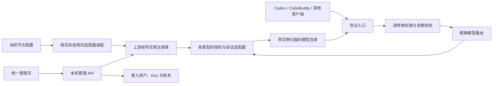

# Bifröst 网关与账号池

2026-11-01。管理界面和 Runtime 根据**当前连接的网关**返回的能力自动装配，不需要选择 Mac、公司内网或其他部署模式。账号池、接入用户与管理员是三种不同身份。

## 运行结构



- **上游账号池**管理提供模型的账号：名称、类型、启停和运行状态。不会创建客户账号或变更客户余额。
- **接入用户**管理使用本站服务的人、个人 Key、模型权限和余额。公司网关没有启用用户服务时，不显示这一区域，也不额外启动用户监听。
- **客户端接入**管理本机 Codex 的官方／网关连接配置。当前客户端登录从账号池移出；这一能力只在实际具备集成服务的节点显示。
- **管理员**继续使用本机回环管理会话、HttpOnly Cookie 和 CSRF；注册用户和普通模型 Key 没有管理权限。尚未实现独立管理员用户名登录。

当前 Mac 默认只装配受管 Claude 和既有用户服务，也可以添加 Cursor、CodeBuddy 或远端 Bifröst。只有已登记并启用的来源才加载；添加这些来源不要求本机 Codex 登录或启动 Codex RPC。账号池主列表只列已接入的实例。公司 Windows 仍用原来的 Bifrost 快捷方式／`Start-Bridge.ps1`，管理页显示它自己配置的账号；可添加 Bifröst 用户来源，将 Mac Claude 合入原有模型列表。

## 模块与唯一配置

| 模块 | 职责 |
| --- | --- |
| `src/upstream-account-store.mjs` | 持久实例元数据、旧配置导入、原子写入、锁和 revision 冲突检测 |
| `src/upstream-accounts.mjs` | 实例管理、类型能力、安全快照、模型归属和请求启停校验 |
| `src/main.mjs` | 根据已登记账号装配已有授权与协议适配器，不把页面可见性当运行隔离 |
| `src/runtime/server-remotes*.mjs` | 远端 Bifröst 凭据引用、独立 Provider 生命周期与目录 |
| `src/model-policy.mjs` | 保留旧模型 ID、选择和权限，向管理页提供绑定账号的目录 |
| `public/account-pool.js` | 按服务端实际实例和可添加类型渲染列表、详情和创建表单 |
| `src/server.mjs` | 原管理会话保护下的节点／账号 API；不具备的旧管理能力不可调用 |

Server 的账号元数据统一保存在私有 `upstream-accounts.json`，不再与 `remote-sources.json` 双写。实际凭据仍由原适配器持有，不集中复制密码或 Token。示例仅展示无密钥的元数据：

```json
{
  "version": 1,
  "revision": 0,
  "accounts": [{
    "id": "legacy-claude",
    "kind": "claude",
    "name": "隔离 Claude",
    "enabled": true,
    "binding": { "slot": "Claude" },
    "createdAt": "2026-11-01T00:00:00.000Z"
  }]
}
```

远端记录的 `binding` 包含固定 HTTPS 用户 API、来源编号、协议及不透明 `credentialRef`。管理响应不返回该引用、凭据路径或完整 Key。Windows Key 用当前用户 DPAPI 加密；Mac 用 Keychain 保存独立密钥，以 AES-256-GCM 加密凭据文件，密钥只通过 stdin 传入保护工具，不进入 argv。安全存储不可用或 Keychain 锁定时不降级保存明文。Mac 密文与当前用户 Keychain 绑定，移到其他机器需重新授权。浏览器中的 Key 提交后清空，不进入 URL 或持久浏览器存储。

首次启动导入旧来源引用和已存在的本机账号槽位；保留原文件、授权和加密记录供回滚。存在规范配置时不回退读取旧配置；文件损坏则拒绝加载，不覆盖重建。重启保留实例 ID、名称和停用状态。写入先取得私有目录锁，再重新读取磁盘校验 revision；失败不修改内存快照。进程被强制结束遗留锁时，只能确认没有配置写入进程后再清理。

## 类型能力与当前边界

| 类型 ID | 当前上限 | 授权与新增方式 |
| --- | --- | --- |
| `codex` | 1 | 独立 Codex 订阅目录；添加后空闲重启，再进入原授权流程 |
| `codebuddy` | 1 | 原员工 OAuth 和安全存储；Windows／Mac 可添加 |
| `cursor` | 1 | 原 SDK／账号授权和安全存储；Windows／Mac 可添加 |
| `claude` | 1 | 当前受管隔离环境；由运行配置登记，页面不复制登录或创建假实例 |
| `with` | 1 | 已配置的旧 With 兼容适配器，不混同于 Mac Claude |
| `bifrost` | 8 | 固定 HTTPS 用户 API＋个人 Key；各实例独立凭据、目录和生命周期 |

类型列表由节点支持的适配器与安全存储能力决定，页面不提供不可用类型。新来源先保存配置，经原服务的空闲重启载入；创建成功不等于已授权或推理通过。未就绪显示“待重启加载”或“待授权”，不会伪装成第二个可用账号。

“添加账号”始终可打开类型选择。受管 Claude 和达到容量的类型会显示具体条件，并禁止提交创建；不会再只给一个无解释的灰按钮。Mac 网页重启会核对当前进程与 KeepAlive LaunchAgent 的归属，沿用原有空闲、取消和响应确认流程；没有可验证的监督服务时仍拒绝网页重启。

停用立即阻止**新请求**并从客户端发布目录移除；已接受的本机调用可以按原生命周期收尾。停用远端实例同时关闭它的 Provider；再次启用需空闲重启。停用不删除账号、Key、模型选择或账本。并发页面提交旧 revision 返回 409，不能覆盖新配置。

未知套餐额度显示“上游未提供可靠余额”，不显示为 0，也不由 Token 统计估算。远端用户额度以远端账本为准，与公司套餐或本站客户余额分开。

## 模型与请求边界

管理目录为每个模型返回 `sourceAccountId` 和显示名称；改名不改变实例或模型 ID。保留原来的 `B-*`、CodeBuddy、Cursor、`Claude-*` 和 `remote/<来源>/<模型>` 别名。模型开关与账号停用分别保存：停用账号不会永久关闭其模型偏好，保存可见模型选择也不会清除未加载来源的旧选择。Mac 的模型开关同时控制其用户入口。

CodeBuddy／Cursor 目录读取失败表示本次刷新未取得结果，不能据此认定来源已经移除模型。同一授权下上次确认的目录继续用于模型选择，管理页仍显示刷新失败；只有成功返回的完整目录才确认模型新增、移除或不可用。目录元数据不授予推理权限，实际请求仍由来源验证当前认证。首次加载、授权变化或账号停用时，旧目录不能使模型重新可用。

每次请求只进入精确登记的来源。公司流量留在公司；选择远端 Claude 才发送到 Mac。远端只使用该用户的 Key，不携带公司登录或管理凭据。故障、零余额、限流和断线不回退到其他账号。工具由发起请求的客户端执行，状态继续绑定原来的用户、会话、来源、模型和授权版本。

当前只统一了实例元数据、装配、发布归属与开关。原生 A/B、CodeBuddy、Cursor 的成熟协议分支继续保留；尚未全部改成一个通用 ModelRouter。既有用量／诊断记录仍主要按渠道和准确模型区分，不改写历史。需要独立凭据与生命周期的同类多账号，以及全面的实例级用量／授权版本迁移，需后续分别实现；当前不开放超过适配器能力的实例数。

虚拟机的 VPS 出口、DNS、IPv6／UDP 限制和无直连回退保持原配置。账号池仅引用既有受管接口，不提供任意命令、路径或宿主端口转发。支付验收继续暂停，公开充值保持关闭。

## Claude 全目录与开放范围

虚拟机 relay 开启 `modelDiscovery.enabled` 后，使用官方 Agent SDK 的 `supportedModels()` 读取登录环境的全部可选项。输入流保持为空，不发送推理提示、执行工具或持久化会话；目录失败时停止发布来源，管理页保留历史条目并标记不可用。[官方 SDK 参考](https://code.claude.com/docs/en/agent-sdk/typescript)。

Default 与显式模型解析到同一模型时合并 Default；保留 `Claude-opus`、`Claude-sonnet` 兼容 ID。长上下文选项使用安全的公开别名，内部保留完整原始值，例如 `claude-fable-5-1[1m]`，不静默改变上下文模式。实测目录包括 Opus、Sonnet、Haiku、Fable 及其他可选版本，具体数量以当前 SDK 返回为准；目录可见不代表新增模型已完成真实推理验收。

原 Opus／Sonnet 开放策略保留，新发现模型默认关闭。目录先成功写入模型策略，再向调用入口暴露；自动刷新也遵守这个顺序。管理页显示全部条目，管理员可以勾选开放。下游用户和 Key 的白名单、余额及模型定价继续独立校验，不会因新增目录或来源自动扩权。

## 当前管理 API

所有接口仅在本机管理会话下可用，写操作另外校验 CSRF、Origin、空闲重启状态和字段白名单。

```text
GET  /api/node                       节点能力与管理会话校验值
GET  /api/upstream-account-types     类型、容量和授权方式
GET  /api/upstream-accounts          安全实例快照与绑定模型
POST /api/upstream-accounts          按类型创建（本机官方授权或远端用户 Key）
POST /api/upstream-accounts/:id      revision + name / enabled
GET  /api/model-settings             当前节点模型与已保存选择
POST /api/model-settings            revision + disabledModels
```

`/api/client-admin` 继续独立管理下游用户和账本。原类型授权接口作为兼容编辑器保留，页面只在选中对应实例时打开。新增账号不能通过表单提供凭据文件路径或执行命令。

## 验证与更新

自动测试覆盖旧配置导入、多个远端独立引用、损坏配置拒绝、并发冲突、磁盘写入失败回滚、停用与恢复、模型选择、请求不回退，以及管理会话／CSRF／Origin 边界。隔离进程测试实际启动 `src/main.mjs`：不给可执行 Codex、残留外部渠道配置仍只加载 Claude；停用和重启后保持测试用户原 Key、余额及模型偏好。

浏览器验收使用真实管理服务与前端、隔离存储和模拟 Provider 元数据，检查页面操作、动态类型、重命名转义、停用恢复、无手动环境切换及 360px 布局。它不代替 Windows DPAPI 或公司员工账号的现场验证。真实用户入口另在 Mac 更新后核对，不将模拟上游结果说成真实推理或支付验收。

部署前备份代码与私有状态；空闲关闭唯一写入进程后更新，再由原监督服务恢复。回滚使用旧代码与备份配置，不并行启动第二份生产用户账本进程，不重新发 Key 或重复增加余额。

受管 Claude 的订阅用量、CLI 上下文上限及实际调用证据见[元数据说明](claude-source-metadata.md)。

## Responses 交付与会话兼容

CodeBuddy、远端 Messages 和 Cursor 共用 `src/protocols/responses-delivery.mjs`。协议内容转换仍由 `responses-messages.mjs` 完成；交付层统一处理实际发送的事件序号、提交前取消、终端整批提交、JSON 错误、可选 HTTP preflight 以及独立资源清理。来源生成完成与客户端响应提交分开记录，清理失败不覆盖已提交的成功结果；取消不等待不配合的底层连接，也不重放模型请求。Cursor 的活回调、已完成检查点和用量归属继续由原适配器维护。

会话操作使用[兼容契约](conversation-compatibility.md)，分别表达完整明文历史、已认证快照、已完成检查点与活执行状态。目录中的工具／图片能力不代表所有会话操作都可用；未确认的来源保持未知。模型管理的能力详情展示这些边界，路由在切换快照作用域前核对当前来源声明，实际解密、身份和授权检查仍由提供方执行。

未适配的 CodeBuddy 增量保留有限字段形状，贯穿源端错误、协议转换、诊断记录与导出。仅记录白名单字段名或 `unknown_key`、类型和长度，不记录原值。协议完整性失败在实际校验点记录固定检查项，说明来自本地映射，不能从上游错误文字推断；客户端错误和管理详情可区分工具索引、参数 JSON、重复结束原因等失败。公共故障矩阵使用模拟上游，在原生输出阶段及客户端可见阶段注入错误、截断、取消和清理挂起，并核对工具结果、实际用量与 preflight，不把这些验证当作真实模型效果验收。
