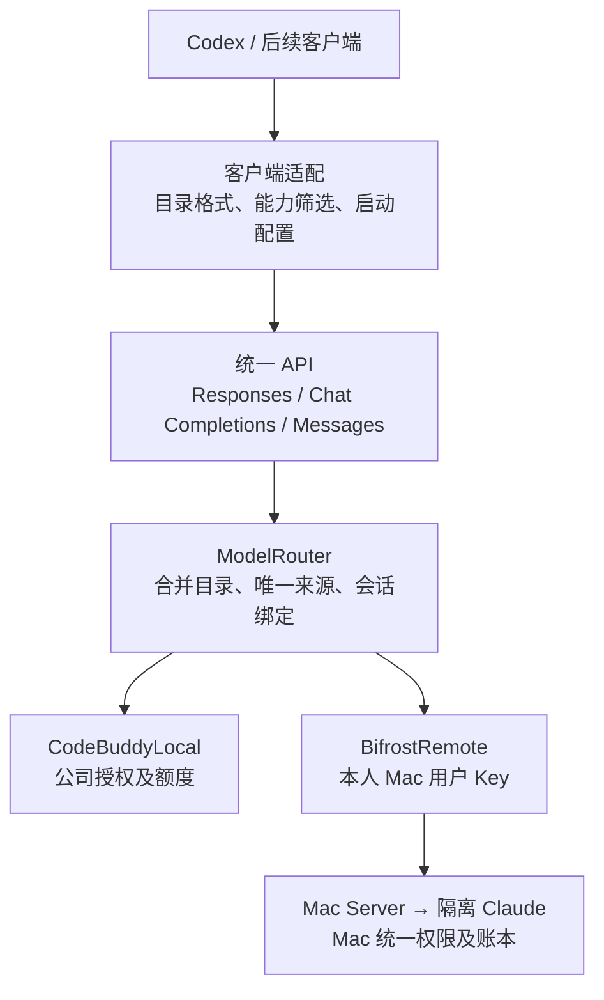

# 客户端、协议与模型来源的扩展边界

Bifrost 的路由不按 Codex、CodeBuddy 等客户端名称分派。客户端读取同一个模型目录，只是可能需要不同的目录格式和配置文件；协议适配独立于客户端，模型来源独立管理凭据、连接和额度。



## 三个扩展点

| 需要扩展的对象 | 位置与契约 | 不应出现的耦合 |
| --- | --- | --- |
| 新客户端 | `src/clients/`：注册 ID、所需协议、目录投影、受限目录参数和可选配置生成器 | 不读取公司或 Mac 凭据，不直接发推理，不创建计费副本 |
| 新协议能力 | `src/protocols/`：转换输入、工具、流式输出、取消、真实用量及隐藏状态 | 不按客户端名称选择供应方，不包含 URL、Key 或公司授权逻辑 |
| 新模型来源 | `src/providers/`：目录快照、刷新、请求、授权代次和关闭 | 不根据 User-Agent 猜客户端，不向客户端发布管理接口或秘密 |

新增使用现有协议的客户端，通常只需一个客户端适配文件并在 `clients/index.mjs` 注册；使用通用 OpenAI `/v1/models` 格式的客户端可直接使用统一 API。新客户端确实需要尚未提供的协议时，补通用协议适配及验收，然后由需要它的客户端复用。不会为每个客户端重新实现 OAuth、权限、来源路由或计费。

`ModelRouter` 和 HTTP 模型分派不导入具体客户端。运行入口通过 `ClientRegistry` 注入目录适配；目录不支持的模型会按协议能力筛除。未知客户端返回 404，不伪装成已经适配。测试注册了独立 Chat 客户端样例来验证扩展无需修改路由；该样例不是一个已上线产品集成。

## Codex：第一个原生目录适配

- 通用目录仍为 `GET /v1/models`，使用 `data` 列表。
- Codex 目录为 `GET /clients/codex/models`，使用 Codex 的 `models`、`slug`、`display_name` 等字段；模型 ID 与统一目录相同。
- 两个目录都在同一个本地端口，需要同一个本地 Key。Codex 可以带经过验证的 `client_version` 查询参数，不接受目标 URL、重复参数或其他代理参数。
- `model_catalog_url` 指向 Codex 目录，`base_url` 指向本地 `/v1`。Codex 的选择器合并显示可用公司模型与远端模型，不切换 Provider 或内外网模式。
- 模型能力取自来源白名单。未知上下文使用网关保守的 32,000 Token 客户端预算，不当作上游最大窗口；未知来源不宣称图片或可控思考档位。
- 原有 CodeBuddy / Cursor 的 Responses 转换核心已抽到 `protocols/responses-messages.mjs`，旧导出保留兼容。远端 Messages 经通用适配器转换为 Responses；因此目前 Mac 服务器本身仍只需提供原有接口。

配置生成和临时 CLI 启动见 [Desktop 使用说明](desktop-gateway.md)。生成的原生配置可用于支持这些字段的 Codex 客户端；桌面 App、扩展、公司 Windows 的实际版本及界面仍需现场核实，不能把本机引擎测试当成所有界面都已经验收。

## 协议与用量

`MessagesResponsesAdapter` 复用统一的 Responses / Messages 转换引擎，可处理客户端函数、自定义工具、命名空间、客户端工具发现、图片及完整历史；不冒充 OpenAI 托管工具、服务端会话或远端 compaction。无法保真映射的参数明确拒绝。

原生 Messages 用量通过只读解析器验证，再序列化为 Responses 的用量；这里不创建账本、不结算或扣费。Mac 仍对实际发送给它的每一次 Messages 请求记账一次。一次工具往返通常有两次推理，这是两次明确请求，不是自动重试。

思考及 redacted thinking 在本地加密封套中保持完整，绑定来源模型、调用范围及授权代次；不解密供应方状态。既有外层 Desktop 封套继续绑定公开模型及协议。上游没有可控思考档位时，已知的客户端全局 effort 提示使用上游默认，响应不回显它已执行；不向上游发送虚假的 effort 控制。未知档位返回错误。

错误、取消、断流和额度不足都不会跨来源回退；生成的 Codex Provider 配置还关闭其请求与流的自动重试。网关仅路由模型 API，客户端工具仍由客户端执行；未来支持更多客户端不会改变这个边界。

## 验收证据

```powershell
node --test tests/client-profiles.test.mjs tests/messages-responses-adapter.test.mjs tests/desktop-*.test.mjs
npm run verify:desktop-codex
```

第二条使用已安装的真实 Codex：在临时 HOME / CODEX_HOME 中启动实际 app-server，确认 `model/list` 同时包含两边的 ID；再分别通过实际 Codex CLI 完成一次真实本地只读工具往返，验证公司与远端隐藏状态、用量及路由。上游为模拟响应，不读取日常登录，也不消耗模型额度。2026-10-25 本机 `codex-cli 0.163.0-alpha.11.2` 已通过，包含命令式取 Key 的实际验证。

2026-10-28 已用本机更新后的 `codex-cli 0.164.0-alpha.11.1` 重新运行同一检查：合并列表仍有两种来源，两边均完成一次本地工具往返并正确接续隐藏状态；同时通过 26 项客户端目录、通用协议和 Desktop 定向测试。上游仍为模拟响应，这次检查不改变真实公司授权或 Mac 模型就绪状态。

真实公司 OAuth、内网接口及额度、Windows DPAPI 与桌面选择器，以及已登录 Claude 的真实工具回合仍待现场验收。源代码可支持某种协议，不代表每一个客户端产品都已完成配置和验收。

官方依据：[Codex 配置参考](https://learn.chatgpt.com/docs/config-file/config-reference)说明 `model_catalog_url`、Responses 协议、命令式认证和重试设置；具体行为另由当前安装的 Codex 程序验证。
