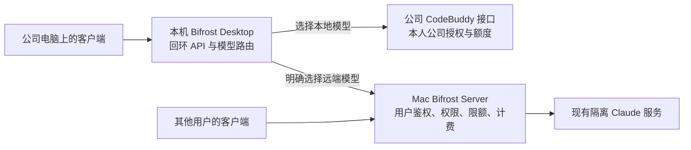

# 本地与远端混合网关架构

状态：Windows Desktop 的基础运行入口、合并目录、模型路由和两种 Provider 已实现，并已增加独立客户端适配及通用 Responses 转换，使用方式见 [Desktop 使用说明](desktop-gateway.md)。已通过模拟上游的离线验收，以及实际 Codex 引擎的合并目录和双来源工具往返；真实公司员工登录、目录、额度及完整远端 Claude 调用仍需在公司电脑验收。现有 Mac 服务、账号库及虚拟机网络保持当前部署。

## 使用方式

同一个 Bifrost 内核，提供两个部署入口：

- **Desktop**：运行在本人公司电脑上，仅监听回环地址。直接连接本人获准使用的公司 CodeBuddy；可选连接远端 Bifrost。
- **Server**：运行在现有 Mac 上，服务公网注册用户，继续管理账号、模型权限、限额和计费，并连接现有隔离 Claude。

公司电脑的客户端只填写一个本地地址和本地 Key，`GET /v1/models` 同时列出公司及远端的可用模型。用户直接选模型，不切换内外网模式、来源页或客户端地址；同名模型标明来源和额度归属。选择模型后，路由自动确定唯一 Provider。其他用户继续填写 Mac 的公网地址和各自的 Bifrost Key，无需安装 Desktop。



| 模式 | 开启的连接 | 入口与身份 | 额度归属 |
| --- | --- | --- | --- |
| Desktop 本地模式 | 公司 CodeBuddy | 本机入口、本地 Key | 公司上游额度，本机统计用量 |
| Desktop 混合模式 | 公司 CodeBuddy、远端 Bifrost | 同一个本地入口；分别配置上游授权 | 按所选来源分别归属 |
| Server | 当前 Mac 的模型来源 | 公网入口、每位用户独立账号和 Key | Mac 的权限及账本 |

本地模式不创建远端连接器，也不读取 Mac Key、请求 Mac 模型目录、联系 Mac 鉴权或要求在 Mac 注册。混合模式下，远端目录刷新在后台独立进行，超时或断线不阻塞本地目录和本地调用。

## 共用的内核

```text
客户端协议与本机/服务端鉴权
             ↓
模型目录 + ModelRouter：按已配置模型绑定唯一来源
             ↓
Provider 接口：目录、协议能力、调用、取消、状态
             ↓
CodeBuddyLocal / BifrostRemote / 现有隔离 Claude 连接
```

Runtime 负责装配；Core 不根据 macOS、Windows 或机器名决定路由。HTTP 处理器不判断“Claude 就走某个端口”，而是通过已解析的 Provider 及协议能力分派。Provider 管理自己的授权、传输与生命周期。

客户端也不进入路由判断。`src/clients/` 通过独立注册表提供目录格式及配置，`src/protocols/` 提供跨客户端复用的协议转换；新增客户端通常只注册适配，不修改公司授权、Mac 账本或模型分派。详见[客户端适配边界](client-adapters.md)。

Provider 的最小契约：

```text
id / kind                       稳定实例编号和适配器类型
catalogSnapshot()               本实例当前模型及能力，不等待其他来源
refreshCatalog(signal)         独立、可取消、有期限的目录刷新
request(protocol, request)     显式协议、模型、调用者范围与取消信号
status() / close()             状态及资源回收
```

可信请求上下文由内核构造，包含 owner/account、session、routeId、来源授权代次；不从客户端 JSON 接受权限、计费归属或转发地址。Provider 失败只结束当前调用，不选择其他 Provider。

## 模型身份与会话

本地目录使用来源命名空间，模型描述显示本地 / 远端及额度来源。以下是实际 ID 格式示例，具体模型取决于账号返回的可用目录：

| 客户端可见 ID | UI 名称 | 实际绑定 |
| --- | --- | --- |
| `local/codebuddy/CodeBuddy-<model>` | 本地 · CodeBuddy · 模型名称 | 指定 CodeBuddy 实例及其目录中的准确别名 |
| `remote/bifrost/Claude-sonnet` | 远端 · Bifrost · Claude Sonnet | 指定远端实例的 `Claude-sonnet` |

别名不携带 URL。ModelRouter 查找已登记映射，不把前缀、请求头、metadata 或请求正文转换为网络目标。重复别名拒绝加载。已有模型 ID 可保留为兼容别名，但必须绑定明确来源。

Desktop 将外层别名映射回上游实际 ID。Mac 仍收到现有 `Claude-*` ID，继续用现有模型白名单和权限检查，不需要为本地命名空间放宽 Mac 的授权规则。

会话状态绑定调用者、会话、路由、上游模型及来源授权代次。Messages 思考签名、redacted thinking 及 Responses opaque state 加一层 Desktop 加密封套，内部上游状态保持不透明；Desktop 不解密供应方状态。显式 `X-Session-Id` 已绑定其他模型或授权时返回 409，换来源应新建聊天。即使不提供该头，封套和既有 CodeBuddy Chat 工具缓存仍按路由及授权隔离；客户端显式提交的普通消息历史由使用者自行管理。

## 身份、凭据与计费

**Desktop 的第一版面向个人使用。** 它用本地 Key 保护 API，复用当前操作系统用户的私有配置，不再建立一套注册用户和余额数据库。监听 `127.0.0.1`，不向公司局域网开放。若将来做公司多人共享节点，应另设计租户及每用户远端授权，不能共享一个人的远端 Key 冒充多人身份。

三类凭据独立：

| 凭据 | 保管方 | 发送目标 |
| --- | --- | --- |
| Desktop 本地 API Key | 本人客户端和本地网关 | 本地入口 |
| 公司 CodeBuddy 授权 | 本地 Provider 的操作系统凭据存储 | 获准的公司 CodeBuddy 接口 |
| 本人 Bifrost 用户 API Key | 本地远端连接器 | 配置的远端 Bifrost HTTPS 模型接口 |

Mac 不接收公司授权，本地 Key 不充当 Mac Key；远端 Key 不转发给 CodeBuddy。远端连接器只调用明确的用户模型接口，不代理 Mac 管理接口、浏览器 Cookie 或任意 URL。

**每次请求只有一处计费权威。**

- 本地 CodeBuddy：使用公司上游额度，Desktop 可统计可信 Token 和状态；不创建 Mac 账目，不把“未配置本地价格”显示成免费。
- 远端 Bifrost：Mac 使用当前用户 Key 检查权限、预留并结算；Desktop 不再次扣费或维护远端余额副本。
- 远端断流或用量缺失：结算归 Mac 的现有待核对流程；Desktop 不自行判定免费、不自动重放推理。

UI 统一显示调用记录，但保留来源和额度归属。远端余额及账单需要用户级只读接口才能在 Desktop 展示；不能用管理员接口替代。目前此项只是后续契约，第一版不承诺复制或同步账本。

## 网络及协议

本地请求从公司电脑发往公司 CodeBuddy 的实际接口。Provider 使用独立传输配置，依照公司 DNS、认证和证书链工作，不借用 Mac 的 VPS，也不通过修改整个进程的代理环境切换两种来源。现有员工授权模块仍使用其固定腾讯接口契约，不能把它当成已验证的任意内网 API。公司侧 DNS、真实接口、员工身份及额度来源，需要在公司机器上确认；本地运行不自动证明上游完全处于内网。

远端连接器使用配置好的 HTTPS origin 和独立凭据，校验证书、拒绝跨目标重定向，只开放已实现的模型 API。目标来自私有配置，不接受客户端指定。公司凭据、内网地址和内部目录不上传 Mac。

协议能力按 Provider 与模型声明：

| 来源 | 当前可复用的协议能力 | 设计要求 |
| --- | --- | --- |
| 本地 CodeBuddy | 已有 Responses、Chat Completions、Messages 适配 | 复用现有实现及账号实际模型能力 |
| 当前 Mac Claude | 原生 Chat Completions、Messages；Desktop 可将 Messages 转为 Responses | 明确区分原生与转换；由通用适配器支持 Codex，Mac 不重复计费 |
| 以后新增来源 | 来自对应适配器 | 不靠模型名称猜测能力 |

BifrostRemote 尽量保持同一协议直通，只映射模型身份及必要会话信息；既有 CodeBuddy 适配器继续处理工具、思考与协议转换。SSE、背压、取消和终态必须保留。目录读取可以有边界内的重试，推理请求不自动重试或跨来源重放。

## 配置形态

以下配置由独立 Desktop 入口加载；不会传给现有 Server `main.mjs`。私有文件为 `~/.bifrost-desktop/desktop.json`：

```json
{
  "version": 1,
  "port": 43160,
  "sources": [
    {
      "id": "codebuddy",
      "kind": "codebuddy-local"
    },
    {
      "id": "bifrost",
      "kind": "bifrost-remote",
      "baseUrl": "https://gateway.example.com/v1",
      "protocols": ["chat-completions", "messages"]
    }
  ]
}
```

纯本地配置只保留第一个来源；无需填写无效的服务器地址或远端 Key。来源编号映射独立的 DPAPI 私有文件，不接受配置内明文 Key、任意凭据路径或监听 Host。Desktop 本地 Key 与状态密钥、本人远端用户 Key、CodeBuddy 授权分别保存。当前安全存储使用 Windows 当前用户 DPAPI，其他操作系统明确拒绝启动，不降级为明文。

Server 保留现有注册页、ClientAccess、ClientBilling、隧道及隔离 Claude 配置。它不会因为 Desktop 支持公司来源就自动发布公司模型或获得连接公司内网的能力。

## 当前代码与后续改造位置

| 已有模块 | 可复用内容 | 待补内容 |
| --- | --- | --- |
| `codebuddy-service.mjs`、`employee-oauth.mjs` | 独立授权、目录、刷新和换号代次 | Desktop 已按需启动；待验证实际公司环境 |
| `providers/codebuddy-local.mjs` | 复用既有模型、工具、Chat / Responses / Messages 适配 | 不重复实现 OAuth 或协议转换 |
| `providers/bifrost-remote.mjs` | 普通用户 Key、固定 HTTPS 模型 API、独立目录 | Messages 可经通用适配器提供 Responses，不增加上游调用 |
| `clients/`、`protocols/` | 客户端目录与配置；统一转换、状态和流式协议 | 后续客户端注册目录 / 配置；新协议补通用转换及验收 |
| `routing/model-router.mjs`、`routing/desktop-wire.mjs` | 合并目录、唯一来源、会话绑定、SSE 与状态封套 | Server 将来可渐进接入同一注册契约 |
| `runtime/desktop*.mjs` | 按配置装配、个人回环 API、独立私有状态 | 后续图形来源设置、Windows 自动启动 |
| `client-server.mjs`、`client-chat.mjs` | Server 用户模型 API、协议处理、SSE | Server 暂沿用现有分派；Desktop 复用 Chat 适配器 |
| `client-access.mjs`、`client-billing.mjs` | Server 的用户、权限、权威账本 | 留在 Server；不强制 Desktop 联系 Mac 或创建同类用户库 |
| `model-discovery.mjs`、`model-policy.mjs` | 目录刷新、能力与授权代次 | 增加来源实例注册及互不阻塞的目录快照 |
| `mac-claude-client.mjs` | Mac 内固定回环连接 | 保留为本机适配器；另增通用 BifrostRemote，不能把它改成任意远端代理 |
| `main.mjs` | 当前 Server 服务装配和生命周期 | 独立 Desktop 入口不加载本模块、Codex RPC、VM、隧道及公网账号组件 |

已新增 `src/routing/`、`src/providers/` 和 `src/runtime/`，既有 Provider 模块通过薄适配器接入。Server 行为保持原样；后续逐步抽离其装配，避免同时重写已验证的账号、计费及协议转换。

## 实施顺序与验收

1. 已实现 Provider 注册、路由及 Desktop 装配，保留 Server 行为及模型 ID。
2. 已实现 Desktop 本地来源，只启动 CodeBuddy 与回环 API，不依赖 Codex CLI、Mac 账号或远端网络。
3. 已实现 BifrostRemote 与同一个合并模型目录；提供 CLI 配置、状态和 CodeBuddy 授权入口。
4. 后续 UI 可增加来源配置及状态；客户端本身直接读取合并目录，不需要来源开关。来源失效时仅影响对应模型，由本人明确选择其他模型。
5. 待在公司机器验证身份、真实目录、网络出口和实际额度；当前 Mac 上的模拟测试不能替代这一步。

关键验收：

- 纯本地模式不读取远端凭据，不产生 Mac 的 DNS、鉴权、目录或推理请求。
- 混合模式中，Mac 不可达、鉴权失败或目录请求不返回，本地仍可调用。
- 本地返回 401、403、429、超时或断流，不产生远端推理请求。
- 只有明确选中远端模型才发送其正文，凭据限定为该用户的 Bifrost Key。
- 相同客户端会话编号在不同来源、不同账号之间不能复用工具或思考状态。
- 一次远端调用只在 Mac 结算一次，本地调用不写 Mac 账本。
- Desktop 拒绝局域网访问、错误 Host、跨站调用、目标重定向和客户端指定转发 URL。
- Mac 原有注册、模型授权、限流、密钥轮换及 VM 网络隔离继续通过原有验收。
