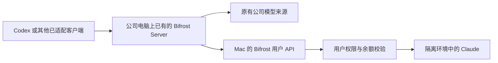

# 已有 Server 网关添加远端来源

这是现有 Server 增加远端来源的接入方式。新版可在本机管理页的“账号池 → 添加账号 → Bifröst 用户账号”输入用户 API 与个人 Key，再空闲重启原服务；也可继续使用下列命令行工具。界面自动读取当前节点，不需要切换公司／Mac 模式。实例容量和兼容边界见 [统一架构](architecture.md)。

已经用 Bifrost 快捷方式或 `Start-Bridge.ps1` 启动公司网关时，直接给这个 Server 增加来源。Codex 的本地地址、网关 Key、公司登录和已有模型配置继续沿用。同一模型列表追加 `remote/bifrost/Claude-sonnet`、`remote/bifrost/Claude-opus`，具体条目以远端账号的权限和在线目录为准。



本功能复用 Desktop 的 `BifrostRemote`、`ModelRouter`、Messages/Responses 转换和状态封装。Server 保留自己的监听、原有 A/B、CodeBuddy、Cursor 路由及 Codex 集成。新部署且尚无 Server 的场景可选择 [独立 Desktop 网关](desktop-gateway.md)。

## 网页与 Mac 配置

在当前网关“账号池”点击“添加账号”，选择 Bifröst 用户账号。Mac 使用当前用户 Keychain 的密钥保护 AES-GCM 凭据文件；Windows 继续用 DPAPI。保存后通过原服务空闲重启加载，不另开第二个用户服务进程。模型是否开放以节点保存的选择为准，用户／Key 权限继续独立校验。

管理页的“账号剩余额度”按远端来源分别显示可用余额、总余额、预留金额、Token 配额与当前 Key 有效期。数据来自该用户的远端账本，不是 Claude 等模型厂商的订阅余额。页面打开、授权变化或点击“刷新额度”时查询，不添加定时轮询。

远端用户服务新增只读 `GET /v1/account`，使用当前用户 Key，返回自身账号、当前 Key 的有效截止和计费字段；没有计费服务时 `billing` 为 null。金额为 CNY 的整数微元，不返回其他 Key、账单历史或凭证。旧服务没有该接口时显示“未提供”，不推算余额。因此需要把本机与 Mac mini 的项目代码一起更新，分别重启 Bifröst 服务；无需重启计算机或客户端。

## Windows 配置

在原有网关仓库目录执行：

```powershell
git pull --ff-only
& .\scripts\Configure-BridgeRemote.ps1
& .\Start-Bridge.ps1 -Restart -Open
```

配置工具依次询问 API 地址和本人的普通用户 Key。API 地址复制账号页中的 `https://…/v1`，用户 Key 为 `bfk_…`，在隐藏输入框输入。请使用注册用户的 Key，不能使用管理或虚拟机内部密钥。工具仅查询模型目录，不发起推理。

凭据使用 Windows 当前用户 DPAPI 保存。配置与后台任务必须使用同一 Windows 用户；没有 DPAPI 时停止，不降级保存明文。原有运行目录仍为 `%USERPROFILE%\.codex-account-bridge`，设置过 `BRIDGE_STATE_DIR` 时沿用该值。`upstream-accounts.json` 统一存放账号实例与固定 HTTPS 地址、来源编号、协议和加密凭据引用；旧 `remote-sources.json` 在首次导入后保留供回滚，不再双写。密钥在独立的 `remote-credentials` 加密记录中。

更新时先写新的独立加密凭据，再原子替换配置引用。失败时保持原有配置和凭据；之前的加密记录保留供回滚。配置锁防止并发覆盖。若配置进程被强制终止，只能在确认没有配置进程运行后清理运行目录中的 `remote-sources.lock` 或 `upstream-accounts.lock`，再重试。

来源在 Server 启动时载入，重启后生效；使用原服务的重启操作即可。配置前会拒绝已启用 Magpie 委托的 Server，防止把来源写入未使用的进程。不要另开占用相同端口的前台网关。

重启网关和 Codex 后，在原有模型选择器选 `remote/bifrost/Claude-opus`。如果客户端缓存目录，需要重新载入模型列表。这里不替换 Codex 的配置文件或登录信息。Codex 使用 Responses 协议和自己的模型目录；自定义提供方参数以 [OpenAI 配置参考](https://learn.chatgpt.com/docs/config-file/config-reference) 为准。

## 路由、计费和故障

- 只有精确登记的模型才能进入来源。模型名不能指定目的 URL，远端请求不携带公司授权、Cookie 或本地管理 Key。
- 公司模型的推理沿原路由；Mac 不接收这些请求的提示或工具结果。远端目录每 15 秒独立刷新，目录读取超时为 5 秒；不阻塞本地模型目录等待远端网络。
- 每次远端推理仅发送一次。认证失败、余额不足、限流和断线均返回该来源的错误，不切换其他模型，也不重试产生额外消费。余额不足保留 HTTP 402 和明确的额度提示。
- Mac 是远端用户的权限和余额账本。公司网关只记录实际用量和诊断，不再扣第二份余额。缺失用量不估算。
- Responses 在本机转换为 Messages。工具由客户端的权限与沙箱控制，Claude 服务端不获得公司电脑的直接执行权限。服务端压缩及不支持的查询参数明确拒绝。
- 思考状态绑定用户、会话、来源、模型和授权版本。同会话切换模型时，经过校验的来源专用思考状态不跨来源转发，明文消息、公开摘要和工具历史保留。网关自有压缩摘要验证原来源和授权后转为标注的用户上下文；无法解封的旧密文仍明确拒绝。更换 Key 不允许复用此前授权的密文。

工具选择默认允许并行时不附加冗余的禁用参数；显式要求单工具时保留限制，由上游明确支持或拒绝，依据 [Anthropic 并行工具说明](https://platform.claude.com/docs/en/agents-and-tools/tool-use/parallel-tool-use)。官方 CLI 目前只接受自动工具选择，不把其他限制静默改成自动模式。

Responses 转换接受 `include: null`，以及 `reasoning.encrypted_content`、`web_search_call.action.sources`、`web_search_call.results`、`file_search_call.results`、`code_interpreter_call.outputs`、`computer_call_output.output.image_url`、`message.input_image.image_url`，并兼容 Codex 的 `output.encrypted_content`。选择器只请求已有响应项的额外返回数据，公开部分参见 [OpenAI 的 include 定义](https://developers.openai.com/api/reference/typescript/resources/responses)。加密输出选择器保留本网关已有的思考接续，不为消息和工具参数伪造 OpenAI 密文。本路由不执行 OpenAI 托管搜索、代码解释器或计算机工具，不向 Messages 传递这些选择器；没有对应响应项时不伪造搜索结果、来源或图片回显。实际不支持的工具及历史、未知选择器和无法提供的 logprobs 仍明确拒绝。

Codex v2 压缩使用同一个 `/responses` 接口，输入以唯一的 `compaction_trigger` 结束。转换器保留完整历史并请求上游仅生成工作摘要，禁止工具调用；只在完整的非空文本响应后生成一个网关自有的加密 `compaction` 检查点。后续按来源、用户、会话、模型与授权版本验证后恢复摘要，不尝试解密 OpenAI 的私有压缩内容。`configuration_update` 的最后一个有效 effort 控制当前推理，不混入对话文字。格式错误、未返回的工具结果、摘要截断或取消均不提交压缩成功。

上游返回的 `caller: {type: 'direct'}` 不存在对应的 Responses 字段。适配器只为已观察到的调用保存作用域内的精确匹配摘要，重放时恢复这个注记；工具 ID、名称、参数必须相符。最多保留 4096 条、6 小时，不保存明文工具参数，不写磁盘。不支持的 caller 注记直接拒绝。网关重启或记录过期后，未完成的工具回合可能需要新建聊天。

## 验证范围

2026-11-01 已用真实 Codex CLI `0.166.0-alpha.5.1` 验证已有 Server 入口：同一原生模型列表包含本地模拟来源和两个远端 Claude；使用实际注册用户 Key，经 Mac 和虚拟机调用 Opus，由 Codex 执行临时文件读取，再携带真实结果续答。两个推理回合均 HTTP 200，回复与随机文件内容一致，Mac 记录实际用量和扣费。

另已验证普通注册用户零余额时返回 HTTP 402／`client_billing_balance_exhausted`，虚拟机会话索引未变化。离线测试覆盖公司流量隔离、远端不可用不回退、Key 保护与发布失败回滚、禁用和撤权、取消、工具元数据接续及篡改拒绝。

这里的公司模型为隔离模拟来源，没有使用真实员工凭据。Windows 当前用户 DPAPI、公司网络和公司现有 Codex 界面仍需在公司电脑现场验收；Mac 上通过不代表这些现场检查已完成。
